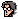
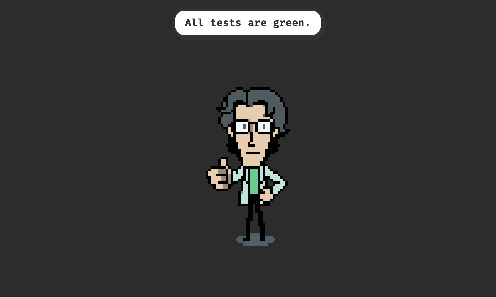
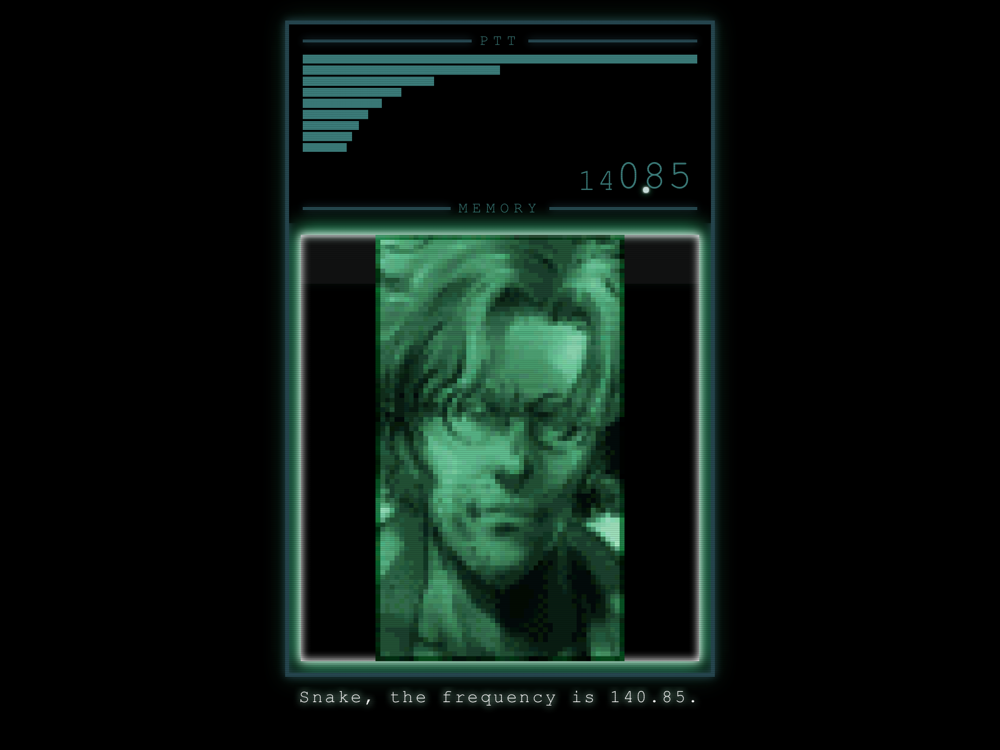
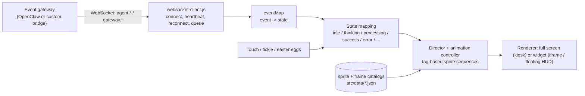
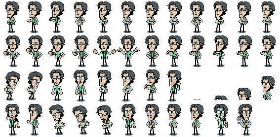

Animated pixel-art companion that gives any LLM or agent WebSocket event stream a reactive face.

# OtaClaw

[](https://github.com/U-N-B-R-A-N-D-E-D/otaclaw/actions)
[-yellow.svg)](LICENSE)
[](ASSETS.md)
[](https://github.com/U-N-B-R-A-N-D-E-D/otaclaw)
[](https://nodejs.org)
[](docs/WEBSOCKET-PROTOCOL.md)

<p align="center">
  
</p>

<p align="center">
  <strong>Hal as the face of your AI</strong><br>
  Self-hosted, your data stays local. Give any inference stack a face that reacts to every interaction.<br>
  <em>Swipe to tickle. Tap to wake. Watch Hal come alive.</em>
</p>

<p align="center"><strong>[ U N B R A N D E D ]</strong> - 2026</p>

<p align="center">
  <a href="#60-second-demo">Demo</a> •
  <a href="#bring-your-own-agent">BYO agent</a> •
  <a href="#modes">Modes</a> •
  <a href="#configuration">Config</a> •
  <a href="INSTALL.md">Install</a> •
  <a href="docs/WEBSOCKET-PROTOCOL.md">Protocol</a>
</p>

---

## What is OtaClaw?

<p align="center">
  
  &nbsp;
  
</p>
<p align="center"><em>Kiosk and codec views.</em></p>

OtaClaw is a **visual front end for any event gateway** — an animated companion
that reacts to LLM / agent traffic over WebSocket. It is the **face**, not the
brain: your agent keeps its model, tools, memory and chat. OpenClaw is a
first-class integration; Discord bots, local scripts, n8n, a custom bridge or
anything that can emit the events in [the protocol](docs/WEBSOCKET-PROTOCOL.md)
work the same way.

Instead of a simple clock like the original [Kojima Productions Otaclock](https://metalgear.fandom.com/wiki/Otaclock), Hal reacts with expressive animations for every exchange:

- **Hmm…** when thinking
- **Processing** while generating
- **Got it!** on success
- **Woah!** when a tool runs
- **Haha!** / **Oops…** for humor and errors

Perfect for:

- **Desktop kiosk / second monitor** — always-on status where you work
- **Floating companion** — a small always-on-top HUD (macOS panel, Chrome/Brave app window)
- **Kiosk displays** — visual feedback for any local inference stack
- **Raspberry Pi + touchscreen** — optional dedicated display

## 60-second demo

No gateway or API key required. The demo opens **only the kiosk** — no browser
tab and no landing page.

```bash
git clone https://github.com/U-N-B-R-A-N-D-E-D/otaclaw.git
cd otaclaw
npm install
npm run demo:kiosk
```

It starts the reference gateway and opens the approved kiosk surface: the native
floating panel on macOS, or a windowless Chromium/app window on Linux/Windows.
The face reacts to a simulated thinking → reply → success cycle every 3 seconds.
Ctrl+C stops the gateway and the kiosk.

If port 18789 is busy: `PORT=19000 npm run demo:kiosk`.

The raw widget URL is for embedding/observing, not the kiosk. Use
`npm run gateway:demo` only when you want the gateway headlessly and will open
the printed widget URL in your own browser.

## Bring your own agent

OtaClaw ships a tiny reference gateway (`examples/gateway.mjs`, Node + `ws`) with
**no inference**. `npm run demo:kiosk` starts it together with the kiosk;
`npm run gateway:demo` is the headless/embed path. You can replace the gateway
with anything that speaks the protocol, or drive it with one HTTP call per event:

```bash
curl -X POST http://127.0.0.1:18789/internal/notify \
  -H 'Content-Type: application/json' \
  -d '{"event":"agent.message.start","payload":{"content":"Reading the repo…"}}'

curl -X POST http://127.0.0.1:18789/internal/notify \
  -H 'Content-Type: application/json' \
  -d '{"event":"agent.message.complete","payload":{"content":"Done: 3 files."}}'
```

In your existing agent handler, call `notify()` where you already send messages:

```js
await notify('agent.message.start', { content: text });
const reply = await myAgent(text);        // your existing pipeline
await sendToChat(reply);                  // your existing Discord/Slack/web chat
await notify('agent.message.complete', {
  content: reply,                         // full text (logs / chat)
  bubble: reply.split(/[.!?]/)[0],         // one short line for the avatar
});
```

That is the whole contract. No SDK, no extra port, no OtaClaw-specific code in
your bot. Full guide, event cheat sheet and webhook example:
[docs/BRING-YOUR-OWN-AGENT.md](docs/BRING-YOUR-OWN-AGENT.md).

## Architecture



| Path | Role |
|------|------|
| `src/index.html`, `src/widget.html` | Development landing (not the kiosk demo) and the embeddable/kiosk face |
| `src/js/websocket-client.js` | Gateway connection, heartbeat, reconnect, offline queue |
| `src/js/core/` | State machine, avatar director, animation controller, speech policy, emotion patterns (unit tested) |
| `src/js/app.js`, `otaclaw.js` | Wiring, touch interaction, floating HUD behavior |
| `src/data/` | Sprite, frame and 1:1 function catalogs |
| `config/config.example.js` | Copy to `config/config.js` (git-ignored); mode, gateway, behavior |
| `examples/gateway.mjs` | Reference BYOA gateway: static server + WebSocket + `POST /internal/notify` + `--demo` |
| `tools/mac-float/` | Optional native macOS floating panel (Swift, `WKWebView`) |
| `deploy/`, `scripts/`, `start-kiosk.sh` | Optional Raspberry Pi / kiosk / desktop helpers |
| `docs/` | Protocol, API, architecture, customization, hardware |

Sources of truth: [docs/ARCHITECTURE.md](docs/ARCHITECTURE.md) (data flow and
invariants), [docs/WEBSOCKET-PROTOCOL.md](docs/WEBSOCKET-PROTOCOL.md) (events),
`src/data/*.json` (frames and functions).

## Modes

| Mode | Use case |
|------|----------|
| **A) Kiosk (default)** | `npm run demo:kiosk` — native float on macOS; windowless kiosk window on Linux/Windows |
| **B) Embed** | The widget URL in an iframe/browser; for embedding, not the default |
| **C) Dedicated display** | Fullscreen kiosk window / Raspberry Pi, with rotation and display tools |

The widget is just a URL, so any display can host one. For the macOS panel,
multiple monitors and rotation, see
[docs/DESKTOP-KIOSK.md](docs/DESKTOP-KIOSK.md).

## Features

### States

| State | Trigger | Animation |
|-------|---------|-----------|
| **Idle** | No activity | Calm pose changes, no notification spam |
| **Thinking** | Message received | Hands on head / contemplative |
| **Processing** | Generating response | Explaining / pointing |
| **Success** | Response complete | Thumbs up |
| **Error** | Error / timeout | Sad / distressed |
| **Laughing** | Humor detected | Laughing |
| **Surprised** | Tool call | Shocked |
| **More** | Signals / `agent.sprite` | Worried, greeting, confident, wink, scared, presenting… |

### Technical

- **WebSocket** — reacts to `agent.*` / `gateway.*` events
- **1:1 sprite functions** — every frame has a stable id/emoji; `agent.sprite`
  picks an exact pose or a tool sequence (see [docs/SPRITE-FUNCTIONS.md](docs/SPRITE-FUNCTIONS.md))
- **Speech bubbles** — one local headline per reply (84 chars in the compact HUD,
  120 in the kiosk), never a raw transcript; see [docs/SPEECH.md](docs/SPEECH.md)
- **Click to copy** — click or tap the bubble (or the codec subtitle) to copy
  that line to the clipboard
- **Notification-aware faces** — explicit `ALERT:`, `Warning:`, `Critical:` or
  ⚠️/🚨 notifications pick `surprised` (Woah) / `worried` / `curious` instead of the
  generic success face
- **Touchscreen** — tickle, tap to wake
- **Vanilla HTML/CSS/JS** — no framework, no build step
- **Configurable** — states, sprites, event mapping, i18n
- **Widget mode** — embeddable via iframe
- **Floating HUD** — compact 9:16 window with hover-only controls and a sprite
  size preference
- **Codec view** — black CRT screen: portrait, animated frequency bars and
  subtitles below the face (no speech bubble, no text inside the bars)
- **Eye-only blink** — a transparent eye overlay, so blinking never swaps the
  body pose

## Configuration

```bash
cp config/config.example.js config/config.js
```

`config/config.js` is git-ignored. The template documents every key; the most
important ones:

```javascript
export const OTACLAW_CONFIG = {
  mode: 'public',                 // 'public' | 'local'
  gateway: {
    host: 'auto',                 // same host as the page; or your gateway host
    port: 18789,
    wsPath: '/ws',
    reconnectInterval: 5000,
    heartbeatInterval: 45000,
  },
  behavior: {
    idleTimeout: 30000,
    touchEnabled: true,
    debug: false,
  },
  states: ['idle', 'thinking', 'processing', 'success', 'error', 'laughing', 'surprised'],
};
```

The same values can be set inline in the URL for the widget:
`widget.html?host=YOUR_HOST&port=18789&hal_ws=ws://YOUR_HOST:18789/ws`.

`personality: 'hal'` enables Hal Emmerich–inspired canned lines; see
[docs/PERSONALITY-HAL.md](docs/PERSONALITY-HAL.md). For theming, custom sprites
and new states, see [docs/CUSTOMIZATION.md](docs/CUSTOMIZATION.md).

## Events

OtaClaw listens for these events (the full contract, including replies and
interactions, is in [docs/WEBSOCKET-PROTOCOL.md](docs/WEBSOCKET-PROTOCOL.md)):

| Event | Description | State |
|-------|-------------|-------|
| `agent.message.start` | Processing started | `thinking` |
| `agent.message.delta` | Token streaming | `processing` |
| `agent.message.complete` | Response complete | `success` |
| `agent.message.error` | Error occurred | `error` |
| `agent.tool.call` | Tool executed | `surprised` / tool pose |
| `agent.signal` | Emoji or state name | any |
| `agent.sprite` | Exact 1:1 frame / cell / tool | any |
| `gateway.idle` | Gateway idle | `idle` |

Payloads are free-form; the face reads `content`, `message`, `bubble`, `summary`
and `state`. Provide `bubble` for exact control of the one-line avatar voice.

### Programmatic API

```javascript
const otaclaw = window.otaclaw;

otaclaw.setState('thinking');
otaclaw.on('stateChange', (newState, oldState) => {
  console.log(`${oldState} -> ${newState}`);
});
```

Full reference: [docs/API.md](docs/API.md).

## Deployment

### OpenClaw canvas

```bash
./deploy/deploy-to-openclaw.sh --local
# or
./deploy/deploy-to-openclaw.sh --host=YOUR_HOST --user=YOUR_USER
```

Then open
`http://YOUR_HOST:18789/__openclaw__/canvas/otaclaw/` (kiosk) or
`.../widget.html` (widget). See [INSTALL.md](INSTALL.md).

### Any static server

OtaClaw is static; serve `src/` (or the repo root) with any web server and point
`gateway.host` / `gateway.port` at your WS gateway.

### Raspberry Pi / kiosk

Chromium kiosk and helper scripts are in `deploy/` and `scripts/`; see
[deploy/kiosk-mode.md](deploy/kiosk-mode.md) and
[docs/PI-DISPLAY-SETUP.md](docs/PI-DISPLAY-SETUP.md).

## Sprites and assets

The bundled set depicts Otacon (see [NOTICE](NOTICE); it is not relicensed by
this repository). The 1:1 catalog contains **43 frames** in a 12×4 grid; five cells
are unused. Everything needed to run ships in this repository: the 43 sprite
frames, the 24 codec portraits, the boot/sleep frames, the eye-blink overlay and
the two preview screenshots in `docs/assets/`. A plain clone loads them from
disk; there is no external asset host. To use your own art:

1. Replace the individual PNGs in `src/assets/sprites/` (transparent PNG).
2. Update `src/data/frame-catalog.json`, `sprite-catalog.json` and
   `sprite-functions.json`.
3. Keep the MIT code license; the character art is third-party.

<p align="center">
  
</p>
<p align="center"><em>The full 12×4 sprite sheet: 43 usable frames.</em></p>

[docs/SPRITE-MAP.md](docs/SPRITE-MAP.md) lists every frame, its id, emoji, state
and file. [docs/CUSTOMIZATION.md](docs/CUSTOMIZATION.md) covers the workflow.

## Contributing

```bash
npm install
npm test        # 111 tests, 6 suites
npm run lint    # 0 errors (a few unused-variable warnings)
npm run gateway:demo
```

See [CONTRIBUTING.md](CONTRIBUTING.md) for the workflow and
[AGENTS.md](AGENTS.md) for the codebase map.

## Limitations

- Version 0.0.x: the event protocol and config keys may still change; see
  [CHANGELOG.md](CHANGELOG.md).
- Automated tests cover `core/` modules; `app.js` and the sprite runtime are
  verified manually.
- The deploy script and Pi helpers are bash and have been exercised on
  Linux/macOS, not on every platform.
- The character art is third-party; see [License and credits](#license-and-credits).

## License and credits

<a id="license-and-credits"></a>

- **Source code:** MIT — see [LICENSE](LICENSE).
- **Character and sprites:** the Otacon / Hal Emmerich character, likeness and
  bundled sprites are © Konami / Kojima Productions (Metal Gear Solid). Included
  for non-commercial fan use only and **not** covered by MIT — see
  [ASSETS.md](ASSETS.md). To reuse the code commercially, replace these assets.
  If the rights holder requests removal, we will comply. See [NOTICE](NOTICE).
- **OpenClaw:** https://github.com/openclaw/openclaw (optional integration).

## Citation

If you use OtaClaw in research or a writeup, cite it with
[CITATION.cff](CITATION.cff) (GitHub shows a "Cite this repository" button).

---

<p align="center"><strong>Have fun. No secrets. Clone and run.</strong></p>
<p align="center">[ U N B R A N D E D ] - 2026</p>
