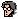
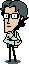
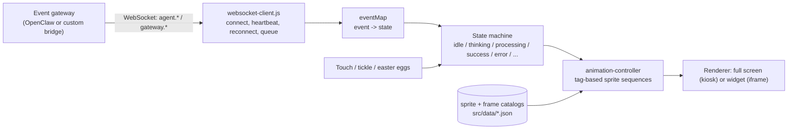
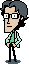
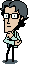
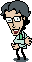
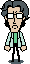

Animated pixel-art companion that gives any LLM or agent WebSocket event stream a reactive face (kiosk, widget, Raspberry Pi).

# OtaClaw

[](https://github.com/U-N-B-R-A-N-D-E-D/otaclaw/actions)
[](https://opensource.org/licenses/MIT)
[](https://github.com/U-N-B-R-A-N-D-E-D/otaclaw)
[](https://nodejs.org)
[](docs/WEBSOCKET-PROTOCOL.md)

<p align="center">
  
</p>

<p align="center">
  <strong>Hal as the face of your AI</strong><br>
  Self-hosted, your data stays local. Give any inference stack a face that reacts to every interaction.<br>
  <em>Swipe to tickle. Tap to wake. Watch Hal come alive.</em>
</p>

<p align="center"><strong>[ U N B R A N D E D ]</strong> - 2026</p>

<p align="center">
  <a href="INSTALL.md">Install</a> •
  <a href="QUICKSTART.md">Quick Start</a> •
  <a href="#two-modes">Two Modes</a> •
  <a href="#features">Features</a> •
  <a href="#installation">Installation</a> •
  <a href="#api">API</a>
</p>

---

## What is OtaClaw?

<p align="center">
  
</p>

OtaClaw is a **visual face for any compatible event gateway** — an animated companion that reacts to LLM / agent traffic over WebSocket. OpenClaw is a first-class integration; HAL Discord bot and custom bridges work the same way. Instead of a simple clock like the original [Kojima Productions Otaclock](https://metalgear.fandom.com/wiki/Otaclock), Hal reacts with expressive animations for every exchange.

Your AI now has NES-style reactions:
- **Hmmm....** when thinking
- **Processing** while generating
- **Got it!** on success
- **Woah!** when surprised (e.g. tool call)
- **Haha!** / **Oops...** for laugh/error

Perfect for:
- **Raspberry Pi + Touchscreen** – Physical AI face
- **Kiosk displays** – Visual feedback for any local inference stack
- **Desktop dashboards** – Always-on status
- **Floating widget** – Embed in corners, sidebars, any UI via iframe

---

## Why this exists

LLM stacks are invisible: you send a prompt and wait. When inference runs locally, on a Raspberry Pi desk display or a spare tablet, you also want to know *at a glance* whether the system is idle, thinking, calling a tool, or has failed. OtaClaw turns the event stream of any gateway into a character that visibly reacts, so state is legible without reading logs.

Design choices:

- **Gateway-agnostic.** It only needs a WebSocket that emits `agent.*` / `gateway.*` events ([protocol](docs/WEBSOCKET-PROTOCOL.md)). OpenClaw works out of the box; any custom bridge in front of your own model can emit the same shapes.
- **No build step, no framework.** Vanilla HTML/CSS/JS served as static files. Runs on a Pi-class device.
- **Semantic, not just on/off.** Events map to states, states map to tagged sprite sequences, so reactions stay coherent with the work being done (see `src/data/sprite-catalog.json`).
- **Degrades gracefully.** If the gateway is unreachable the UI falls back to a demo mode instead of going blank.

## Architecture



| Path | Role |
|------|------|
| `src/index.html`, `src/widget.html` | Full-screen kiosk page and embeddable widget |
| `src/js/websocket-client.js` | Gateway connection, heartbeat, reconnect, offline queue |
| `src/js/core/` | State machine, animation controller, emotion patterns (unit tested) |
| `src/js/app.js`, `otaclaw.js` | Wiring, touch interaction, speech bubbles |
| `src/data/` | Sprite and frame catalogs (tags, sequences) |
| `config/config.example.js` | Copy to `config/config.js` (git-ignored); mode, gateway, behavior |
| `deploy/`, `scripts/`, `start-kiosk.sh` | Optional Raspberry Pi / kiosk deployment helpers |
| `tools/needle-bench/` | Experimental scripts benchmarking tiny tool-calling models for an animation "director"; not used at runtime |

## Show, don't tell

All previews below are real frames from `src/assets/sprites/`.

| State | Trigger event | Preview |
|-------|---------------|---------|
| Idle | `gateway.idle` |  |
| Thinking | `agent.message.start` |  |
| Surprised | `agent.tool.call` |  |
| Success | `agent.message.complete` |  |
| Laughing | humor detected |  |
| Confused | ambiguous result |  |
| Frustrated | repeated failure |  |

No animated GIF or video is shipped yet; to see motion run the demo (`?demo=1`, below).

## Verified quickstart (no gateway needed)

Requires Node.js 16+ (checked with Node 20+).

```bash
git clone https://github.com/U-N-B-R-A-N-D-E-D/otaclaw.git
cd otaclaw
npm install          # dev tools only (jest, eslint, serve)
npm test             # 56 tests, 2 suites
npm run lint         # 0 errors (a few unused-variable warnings)
npx serve src -p 8080
# open http://localhost:8080/?demo=1   (full screen, simulated events)
# open http://localhost:8080/widget.html   (embeddable widget)
```

Checked on 2026-10-12: `npm install`, `npm test` (56 passed), `npm run lint` (0 errors, 6 warnings) and `npm run build` (no-op by design) succeed, and the static server returns HTTP 200 for `/?demo=1`, `/widget.html` and sprite assets. Visual behavior in a real browser was not re-verified in this pass.

## Limitations and status

- Version 0.0.x: the event protocol and config keys may still change; see [CHANGELOG.md](CHANGELOG.md).
- Only two unit-test suites exist (core state/animation and config stability); the WebSocket client, kiosk scripts and deploy script are not covered by automated tests.
- The deploy script and Pi kiosk helpers are bash-only and have been exercised on Linux/Pi hardware, not on every platform listed under Hardware Support.
- Sprites are a fixed 48-frame character set; custom characters require editing the catalogs (see [docs/CUSTOMIZATION.md](docs/CUSTOMIZATION.md)).
- The character art is third-party; see [License](#license-and-credits).
- Roadmap items are intentions, not commitments, and are not part of this documentation.

## Prerequisites

- **An event gateway** that emits `agent.*` / `gateway.*` WebSocket events (see [docs/WEBSOCKET-PROTOCOL.md](docs/WEBSOCKET-PROTOCOL.md))
  - OpenClaw: `npm install -g openclaw` then `openclaw onboard`
  - Or HAL Discord bot / any custom bridge in front of your LLM
- **Node.js 16+** – For the dev server (`npm start`)
- **Bash** – Deploy script requires bash (Linux, macOS, or WSL/Git Bash on Windows)

---

## Quick Start

### Option 1: Public Mode (Default – OpenClaw or any remote gateway)

```bash
git clone https://github.com/U-N-B-R-A-N-D-E-D/otaclaw.git
cd otaclaw

# Copy config template
cp config/config.example.js config/config.js

# Deploy (OpenClaw canvas path) or serve locally and point gateway.host/port
./deploy/deploy-to-openclaw.sh --host=YOUR_GATEWAY_HOST --user=YOUR_USER
```

**What is Public Mode?**
- Connects to any compatible event gateway (local or remote)
- Uses standard `agent.*` / `gateway.*` WebSocket events
- Works OOTB with OpenClaw; same events work with HAL or a custom bridge
- Falls back to demo mode if no connection
- **Best for:** Users who want a face on top of whatever inference they already run

### Option 2: Local Mode (Raspberry Pi + Local Inference Cluster)

```bash
git clone https://github.com/U-N-B-R-A-N-D-E-D/otaclaw.git
cd otaclaw

# Configure for local inference cluster
cp config/config.example.js config/config.js

# Edit config.js to enable local mode:
# mode: 'local',
# gateway: { host: '192.0.2.100', port: 18789 },
# localCluster: {
#   nodes: ['192.0.2.10', '192.0.2.11'],  # Your local inference nodes
#   modelName: 'Qwen3.5-4B',
#   showClusterStatus: true
# }

# Deploy to your Pi
./deploy/deploy-to-openclaw.sh --host=YOUR_PI_HOST --user=pi
```

**What is Local Mode?**
- Connects to a local inference cluster (e.g., a few small machines running a local model) via any event gateway
- Shows cluster health status in debug panel
- Extended timeouts for local network inference
- **Best for:** Users with local LLM inference setups

### Development Server (no gateway)

```bash
npm start
# or
npx serve src -p 8080
```

**Dev server features:**
- Demo mode with simulated interactions
- All animations work without a live gateway
- URL params: `?demo=1`, `?emotions=1`, `?kiosk=1`

See [QUICKSTART.md](QUICKSTART.md) for detailed display modes and configuration.

---

## Two Modes

| Mode | Use case |
|------|----------|
| **A) Resizable widget** | Floating window on Linux desktop, embeddable iframe, sidebar |
| **B) Fullscreen + rotation** | Dedicated display (Pi, tablet), with rotation and backdrop controls |

Mode B: Long-press or tap ⚙ for Face rotation, Full window, Backdrop color.

---

## Features

### Emotional States
| State | Trigger | Animation |
|-------|---------|-----------|
| **Idle** | No activity | Gentle breathing, occasional blink |
| **Thinking** | Message received | Hands on head, thinking pose |
| **Processing** | Generating response | Eyes moving, concentration |
| **Success** | Response complete | Thumbs up, big smile |
| **Error** | Error/timeout | Crying animation |
| **Laughing** | Humor detected | Laughing with closed eyes |
| **Surprised** | Tool call | Wide eyes, shocked expression |

### Technical Features
- 🎯 **WebSocket** – Real-time reaction to gateway events (`agent.*` / `gateway.*`)
- 📱 **Touchscreen** – Raspberry Pi displays
- ⚡ **Lightweight** – Vanilla HTML/CSS/JS, no frameworks
- 🔧 **Configurable** – States, sprites, event mapping, i18n
- 🖼️ **Sprite catalog** – 48 frames, tag-based semantic selection
- 📦 **Widget mode** – Embeddable via iframe (`widget.html`)
- 🌐 **Full emotional range** – Tag-to-frame mapping for worried, waving, scared, confident, wink, etc.

---

## Installation

### Requirements

- A compatible **event gateway** (OpenClaw, HAL Discord bot, or custom WS bridge) — see [WEBSOCKET-PROTOCOL.md](docs/WEBSOCKET-PROTOCOL.md)
- Modern web browser (Chrome, Firefox, Safari, Edge)
- For Raspberry Pi: Chromium browser + touchscreen (optional)

**Windows:** Deploy requires bash (WSL or Git Bash). Dev server (`npm start`) works with Node.js.

### Deploy to OpenClaw Canvas

**Same machine (OOTB with Clawdbot):**
```bash
git clone https://github.com/U-N-B-R-A-N-D-E-D/otaclaw.git
cd otaclaw
./deploy/deploy-to-openclaw.sh --local
```

**Remote host:**
```bash
./deploy/deploy-to-openclaw.sh --host=YOUR_OPENCLAW_HOST --user=YOUR_USER
```

Config uses `host: 'auto'` by default so WebSocket host follows the current page host.

### Full-Screen Display (Kiosk)

For a dedicated display (Raspberry Pi, tablet, second monitor):

```bash
# Quick: Chromium kiosk
chromium-browser --kiosk --app=http://localhost:18789/__openclaw__/canvas/otaclaw/
```

See [deploy/kiosk-mode.md](deploy/kiosk-mode.md) for systemd service, auto-start, and platform-specific setups.

### Widget / Embed

Use OtaClaw as a floating widget in other UIs:

```html
<!-- iframe embed -->
<iframe src="http://localhost:18789/__openclaw__/canvas/otaclaw/widget.html"
  width="200" height="300" style="border:none; border-radius:12px;"></iframe>
```

See [docs/OPENCLAW-INTEGRATION.md](docs/OPENCLAW-INTEGRATION.md) for:
- Emitting `otaclaw.frame` for semantic reactions (tag or col,row)
- Clawdbot/agent integration
- Tag-to-frame catalog and `config.sprites.tagToFrames`
- [docs/OTACLAW-AGENT.md](docs/OTACLAW-AGENT.md) – Agent prompt template for full emotional range

---

## Configuration

### Basic Configuration

Edit `config/config.js`:

```javascript
export const OTACLAW_CONFIG = {
  // Event gateway connection (OpenClaw, HAL, or custom)
  gateway: {
    host: 'auto',               // Use current page host (recommended)
    port: 18789,                // Gateway port
    wsPath: '/ws',              // WebSocket endpoint
    reconnectInterval: 5000,    // Reconnect every 5s if disconnected
    heartbeatInterval: 45000,   // Lower network/CPU cost
    staleThreshold: 120000,     // Force reconnect if connection is stale
    maxQueuedMessages: 120,     // Prevent offline queue memory growth
  },
  // Legacy alias still works: openclaw: { ... }
  // Behavior settings
  behavior: {
    idleTimeout: 30000,       // Return to idle after 30s
    animations: true,         // Enable CSS animations
    lowPowerMode: true,       // Disable costly flash/pop effects
    sounds: false,            // Sound effects (requires interaction)
    touchEnabled: true,       // Touch interactions
    debug: false,             // Show debug info
  },
  
  // Available states
  states: [
    'idle', 
    'thinking', 
    'processing', 
    'success', 
    'error', 
    'laughing', 
    'surprised'
  ],
  sprites: {
    basePath: 'assets/sprites/',
    sheetFile: 'otaclock-original',
    format: 'png',           // png | webp
    sheetWidth: 567,
    sheetHeight: 278,
    cellWidth: 47,
    cellHeight: 70,
    displayTargetHeight: 320,
    idleBaseDelayMs: 3000,
    idleJitterMs: 1200,
  },
};
```

### Hal (Otacon) personality

Set `personality: 'hal'` in config to use Hal Emmerich–inspired speech — varied, nerdy, loyal reactions from the Metal Gear Solid character. See [docs/PERSONALITY-HAL.md](docs/PERSONALITY-HAL.md).

### Customization

See [docs/CUSTOMIZATION.md](docs/CUSTOMIZATION.md) for:
- Creating custom sprites
- Adding new emotional states
- Changing animations
- Theming (colors, sizes)

---

## API

### WebSocket Events

OtaClaw listens for these events from OpenClaw:

| Event | Description | State |
|-------|-------------|-------|
| `agent.message.start` | Processing started | `thinking` |
| `agent.message.delta` | Token streaming | `processing` |
| `agent.message.complete` | Response complete | `success` |
| `agent.message.error` | Error occurred | `error` |
| `agent.tool.call` | Tool executed | `surprised` |
| `gateway.idle` | Gateway idle | `idle` |

### Programmatic API

```javascript
// Get OtaClaw instance
const otaclaw = window.otaclaw;

// Set state manually
otaclaw.setState('thinking');

// Listen for state changes
otaclaw.on('stateChange', (newState, oldState) => {
  console.log(`Changed from ${oldState} to ${newState}`);
});

// Send message to OpenClaw
otaclaw.send({
  type: 'chat.message',
  content: 'Hello!'
});
```

Full API documentation: [docs/API.md](docs/API.md)

---

## Hardware Support

### Tested Configurations

| Device | Screen | Touch | Status |
|--------|--------|-------|--------|
| Raspberry Pi 4 | Official 7" Touchscreen | ✅ | Fully supported |
| Raspberry Pi 3B+ | HDMI + USB Touch | ✅ | Fully supported |
| Raspberry Pi Zero 2 W | Waveshare 3.5" LCD | ✅ | Supported |
| Desktop PC | Any monitor | ❌ | Supported |
| Mac | Any monitor | ❌ | Supported |

See [docs/HARDWARE.md](docs/HARDWARE.md) for detailed guides.

---

## Sprites & Assets

### Included Sprites

The bundled sprite set depicts the Otacon character (see [NOTICE](NOTICE) for ownership; it is not relicensed by this repository). You can replace it with:

1. **Original Otacon sprites** from Metal Gear Solid (fan-made recreations)
2. **Custom pixel art** in the same style
3. **3D renders** converted to sprite sheets
4. **Any character** you want as your AI face

### Sprite Format

Each state needs:
- `assets/sprites/{state}/frame-1.png`
- `assets/sprites/{state}/frame-2.png`
- ... (as many frames as needed for animation)

Recommended: PNG with transparency, 256x256px minimum.

---

## Contributing

We welcome contributions! See [CONTRIBUTING.md](CONTRIBUTING.md) for guidelines.

### Development Setup

```bash
# Clone repository
git clone https://github.com/U-N-B-R-A-N-D-E-D/otaclaw.git
cd otaclaw

# Install dev dependencies (optional, for npm scripts)
npm install

# Serve locally for development
npm start
# Or: npx serve src -p 8080
# Open http://localhost:8080/
```

---

## License and credits

<a id="license-and-credits"></a>

- Source code: see [LICENSE](LICENSE) (MIT text, copyright "[ U N B R A N D E D ]").
- Character art: the Otacon / Hal Emmerich character, image, likeness and bundled sprites are (c) Konami / Kojima Productions (Metal Gear Solid); we credit them as the original creators. This is a free, open, unofficial fan project with no affiliation, and the sprites are not relicensed here. If the rights holder requests removal, we will comply. See [NOTICE](NOTICE).
- OpenClaw: https://github.com/openclaw/openclaw (optional integration).

## Citation

If you use OtaClaw in research or a writeup, cite it with [CITATION.cff](CITATION.cff) (GitHub shows a "Cite this repository" button).

## Changelog

See [CHANGELOG.md](CHANGELOG.md). Contributor and agent guidance: [CONTRIBUTING.md](CONTRIBUTING.md), [AGENTS.md](AGENTS.md).

---

<p align="center"><strong>Have fun. No secrets. Clone and run.</strong></p>
<p align="center">[ U N B R A N D E D ] - 2026</p>
